# PRÁCTICA 2.3: Instalar clientes para tres SGBD

**Asignatura:** ASIR 2 - SGBD  
** Carla González Da Costa  
**Fecha:** 17/10/2026

## Instrucción y objetivo de esta práctica

En esta práctica voy a instalar, configurar y probar diferentes clientes (tanto de línea de comandos como gráficos y web) para conectarme a tres Sistemas Gestores de Bases de Datos: Oracle Database 23ai Free, PostgreSQL y MariaDB.

El objetivo principal es comprobar que las tres bases de datos funcionan bien y asegurarme de que puedo conectarme a ellas y gestionarlas sin problemas usando diferentes programas desde mi propio equipo.

Voy a verificar que los tres servicios de la práctica anterior, funcionan correctamente: Oracle, MariaDB y PostgreSQL.

Utilizo los siguientes comandos:

- `sudo podman ps`: verificar contenedor oracle y puerto 1521.
- `sudo systemctl status 'servicio'`: ver si el servicio está activo.
- `nc -zv localhost 'puerto'`: verificar si el puerto está levantado y la IP, en este caso localhost.
- Entrar en el gestor y `SHOW PDBS`: ver base de datos oracle.
- `SELECT user name —`: ver el nombre del usuario.

| Servicio | Activo | IP | Puerto | Base | Usuario |
| -------- | ------ | -- | ------ | ---- | ------- |
| Oracle | X | `127.0.0.1` | `1521` | `FREEPDB1` | `orauser` |
| MariaDB | X | `127.0.0.1` | `3306` | `dbm` | `muser` |
| PostgreSQL | X | `127.0.0.1` | `5432` | `dbpg` | `pguser` |

## 1. Clientes para Oracle Database (en Mint/Debian)

### 1.1 Cliente gráfico: SQL Developer

**1. Instalo Java Development Kit (JDK) 17** porque Oracle SQL Developer está desarrollado en Java y necesita un entorno de ejecución compatible para iniciar su interfaz gráfica.

```bash
sudo apt update

sudo apt install -y openjdk-17-jdk

java -version
```

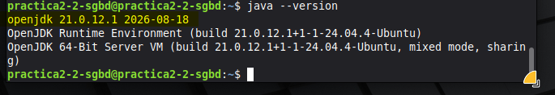

**2.** Inicialmente descargué el archivo ZIP de SQL Developer y lo descomprimí en el directorio `/opt`:

```bash
sudo unzip sqldeveloper-26.2.0.186.2220-x64.zip -d /opt/
```

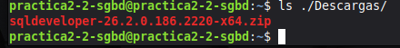

**3.** Voy a crear una especie de acceso directo a la aplicación SQL Developer. He escrito todos estos comandos:

```bash
sudo tee /usr/share/applications/sqldeveloper.desktop > /dev/null <<'EOT'
[Desktop Entry]
Version=1.0
Name=SQL Developer
Comment=Entorno de desarrollo SQL
Exec=/opt/sqldeveloper/sqldeveloper.sh
Icon=/opt/sqldeveloper/icon.png
Terminal=false
Type=Application
Categories=Development;Database;
Keywords=database;db;sql;query;administration;
EOT
```

- `Name=SQL Developer`: nombre del menú.
- `Exec=/opt/sqldeveloper/sqldeveloper.sh`: ruta del archivo que debe ejecutarse al hacer click.
- `Icon=/opt/sqldeveloper/icon.png`: imagen del icono.
- `Categories=Development;Database;`: indica la categoría en Linux Mint.

Verificamos que se ha creado la interfaz.

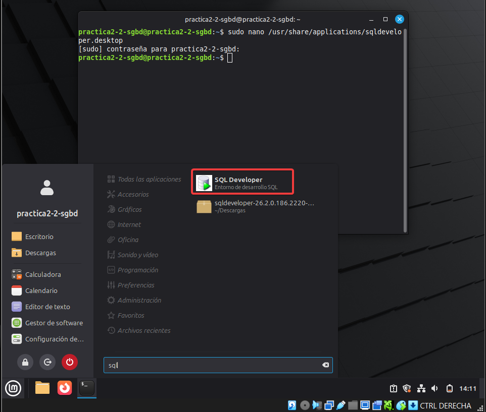

**4. INCIDENCIA:** Al ejecutar SQL Developer aparecieron errores relacionados con la configuración de Java y el módulo `javafx.base`. Al comprobar los archivos de la instalación, observé que el paquete ZIP descargado contenía bibliotecas JavaFX para Windows y macOS, pero no para Linux. Por tanto, esta instalación no era adecuada para mi sistema operativo.

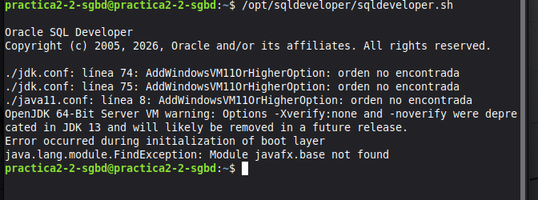

**5.** Busqué información, porque no sabía como solucionarlo exactamente. Para ello, descargué el paquete: `sqldeveloper-26.2.0-186.2220.noarch.rpm`

Este paquete está destinado a instalar SQL Developer en Linux. Esta alternativa es porque el ZIP que había utilizado no contenía los componentes necesarios para Linux.

Comandos que utilicé:

- `sudo apt install rpm -y`
- `sudo rpm -Uvh --nodeps ~/Descargas/sqldeveloper-26.2.0-186.2220.noarch.rpm`: Este comando instala el paquete RPM de Oracle SQL Developer en el sistema, con permisos de administrador, omitiendo la comprobación de dependencias.

**6. Comprobar instalación**, lo hago desde el script de inicio: `/opt/sqldeveloper/sqldeveloper.sh`

La interfaz gráfica se abrió correctamente y apareció la ventana para importar las preferencias de una instalación anterior.

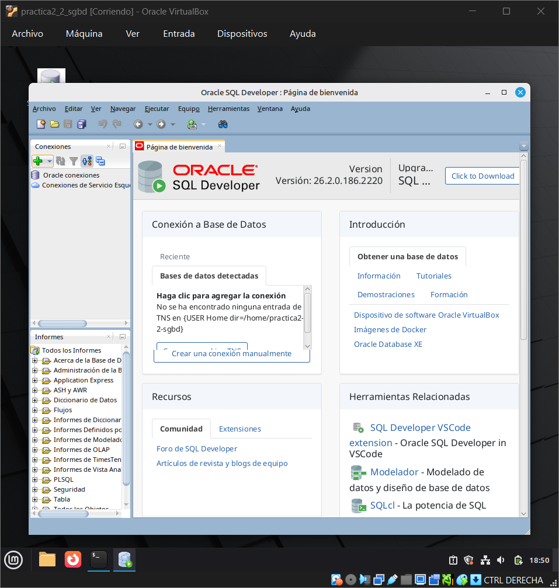

**7. Conexión con Oracle Database:** Desde el panel *Conexiones* de SQL Developer, creo una conexión con los siguientes parámetros:

- **Usuario:** `orauser`
- **Puerto:** `1521`
- **Servicio:** `FREEPDB1`

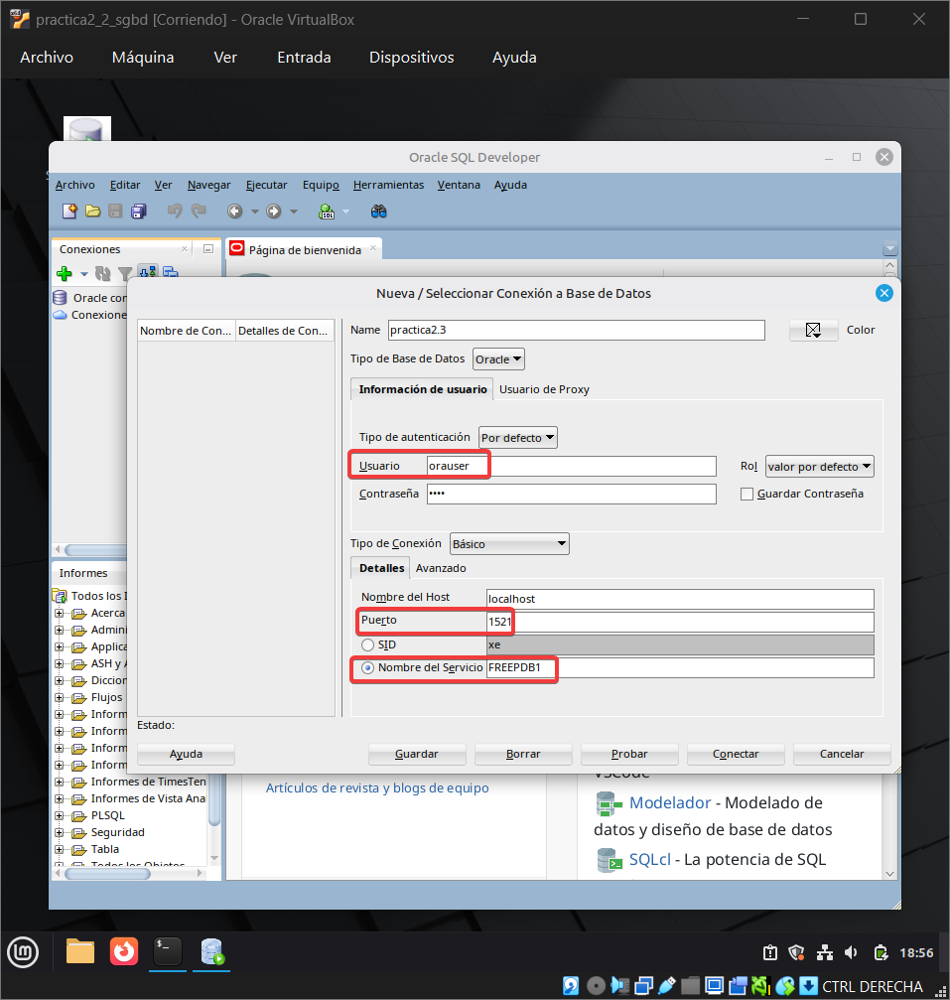

Guardo la conexión y pruebo una consulta para verificar que funciona bien.

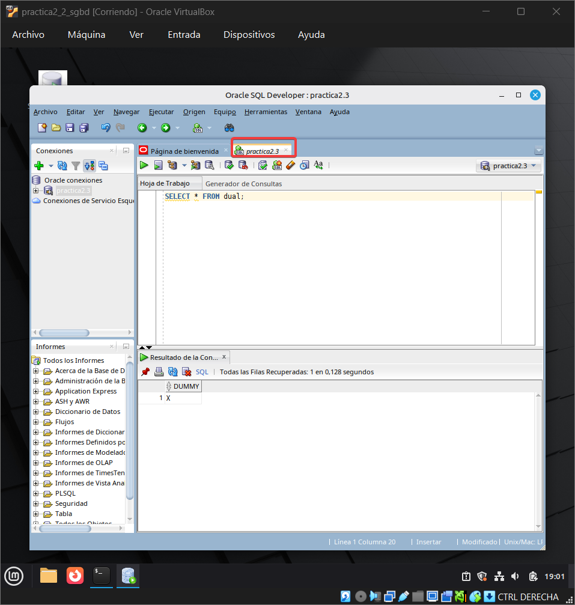


### 1.2 Cliente gráfico: VS Code y extensión SQL Developer

**1.** Voy a la página: [https://code.visualstudio.com/](https://code.visualstudio.com/) y descargo el `.deb` para Linux.

**2.** Voy a la carpeta de descargas donde tengo el `.deb`:

```bash
cd ./Descargas
```

**3.** Instalo el paquete `.deb`:

```bash
sudo apt install ./code_1.142.0-1792035033_amd64.deb
```

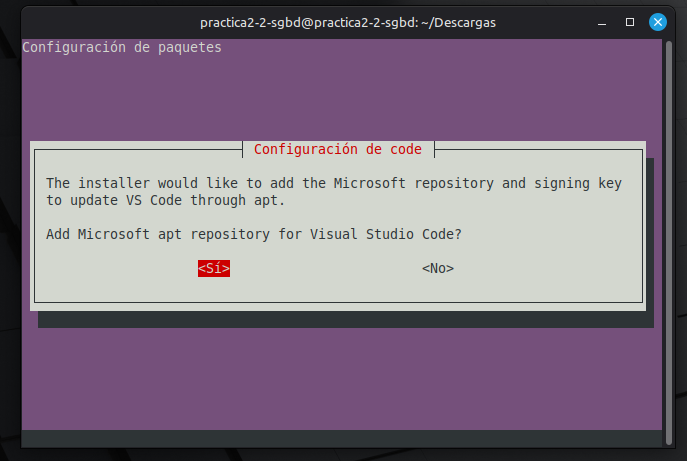

**4.** Compruebo que se ha instalado bien:

```bash
code --version
```

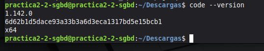

**5.** Instalo la extensión Oracle SQL Developer en VS Code.

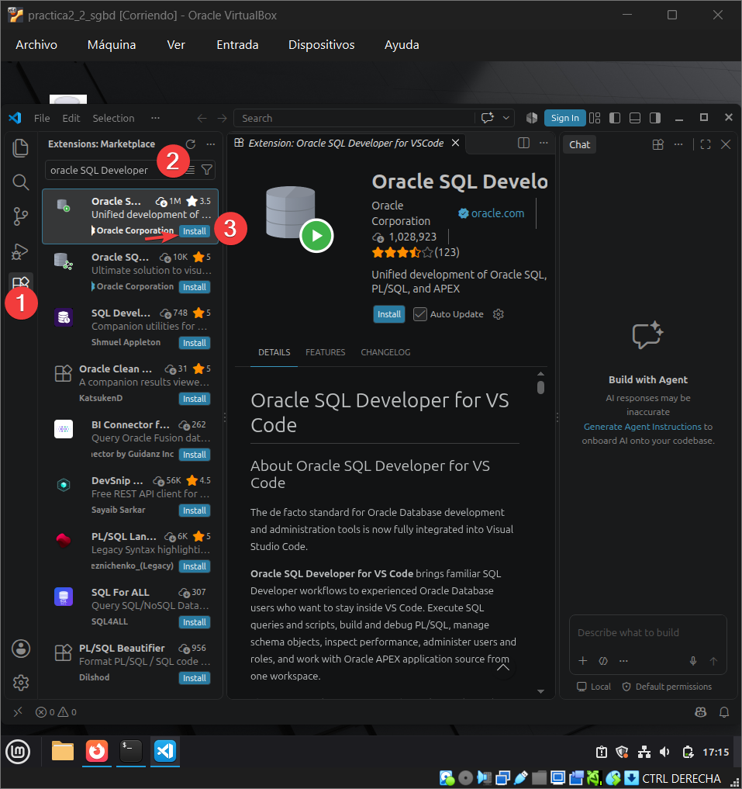

**6.** Creo una nueva conexión a `FREEPDB1` como `orauser`.

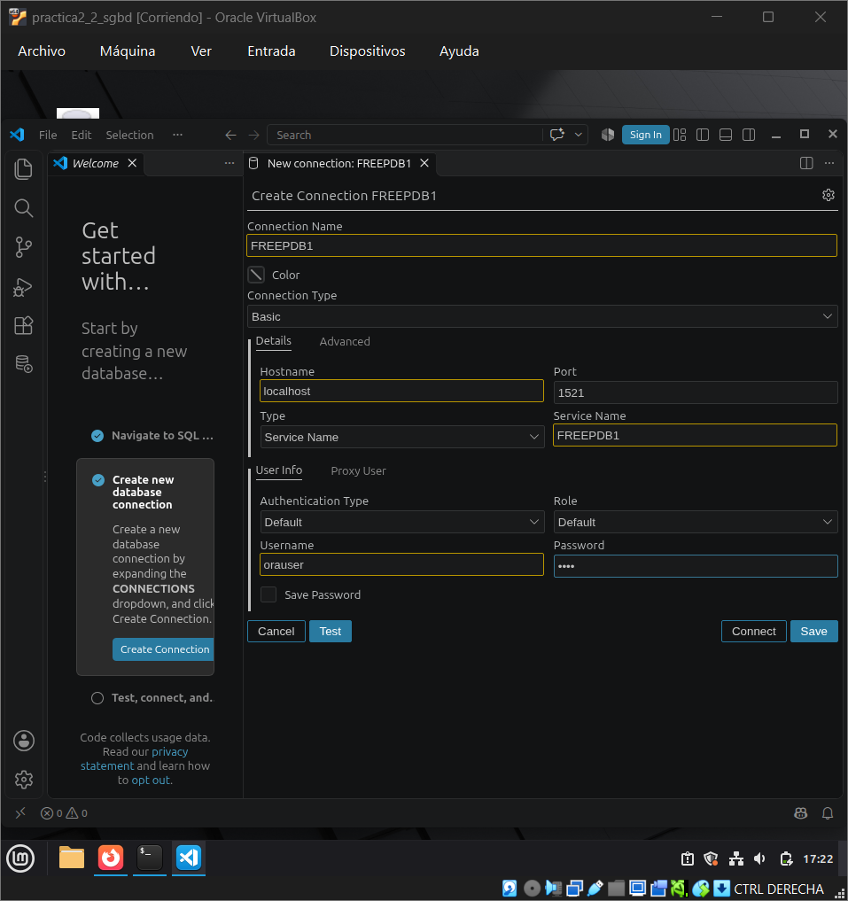

### 1.3 Cliente de terminal: SQL*Plus

**1.** Entro en la página de [Oracle Instant Client Downloads](https://www.oracle.com/database/technologies/instant-client/downloads.html) y descargo los ZIP de Basic y SQL*Plus.

**2.** Descomprimo los dos archivos `.zip`:

1. `cd ~/Descargas`
2. `unzip instantclient-basic.zip -d ~/oracle-client`
3. `unzip instantclient-sqlplus.zip -d ~/oracle-client`

**3.** Ejecuto el siguiente comando:

```bash
ls ~/oracle-client
```

Este comando lista el contenido del directorio donde se descomprimieron los archivos. La salida confirma que la descompresión de los paquetes ZIP de Oracle Instant Client ha generado con éxito la subcarpeta `instantclient_23_7`, que agrupa el entorno de ejecución y las librerías requeridas para interactuar con la base de datos Oracle 23ai Free desde la terminal.

**4.** Entro en el directorio `instantclient_23_7` y compruebo que está el ejecutable.

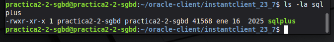

**5.** Cuando descargo el cliente de Oracle por terminal (`Instant Client`), el sistema operativo no sabe dónde están guardados sus archivos ejecutables ni sus librerías. Estos dos comandos `export` sirven para decirle temporalmente a tu terminal dónde buscar.

1. `export LD_LIBRARY_PATH="$HOME/oracle-client/instantclient_23_7:$LD_LIBRARY_PATH"`: le indica al sistema dónde están las librerías internas que necesita Oracle para funcionar.

2. `export PATH="$HOME/oracle-client/instantclient_23_7:$PATH"`: añade la carpeta del programa a las rutas del sistema para que puedas escribir `sqlplus` desde cualquier sitio sin tener que poner la ruta entera.

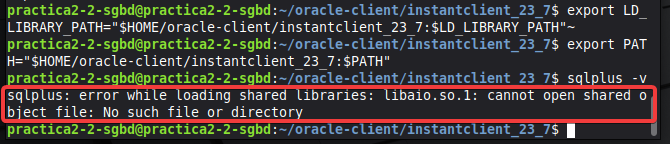

**INCIDENCIA:**

Para esta parte de la incidencia he tenido que buscar un poco de información de porqué me daba error porque no lo entendía bien y he llegado a esta conclusión:

El programa de Oracle (`sqlplus`) requiere obligatoriamente una librería de Linux llamada `libaio` (que gestiona entradas y salidas). Como mi versión de Ubuntu/Mint no la traía instalada por defecto, el programa fallaba. Al instalarla con `apt`, el archivo se creó con un nombre un poco largo (`libaio.so.1t64`), pero Oracle busca un nombre más corto (`libaio.so.1`). El comando `ln -s` crea un "puente" o acceso directo virtual para que el archivo tenga el nombre exacto que Oracle espera encontrar.

Y estos son los siguientes pasos que he realizado para solucionar el problema:

Voy a instalar la biblioteca `libaio`.

- `sudo apt update && sudo apt install libaio1t64`
- `sudo ln -s /usr/lib/x86_64-linux-gnu/libaio.so.1t64 /usr/lib/libaio.so.1`: Este comando crea un acceso directo para que Oracle encuentre la librería con el nombre exacto que busca y no vuelva a fallar `libaio.so.1t64`.

**3.** Verifico la versión de SQL*Plus:

```bash
sqlplus -v
```

**4.** Inicio sesión con mi usuario de Oracle y el servicio `FREEPDB1`:

```bash
sqlplus orauser@//localhost:1521/FREEPDB1
```

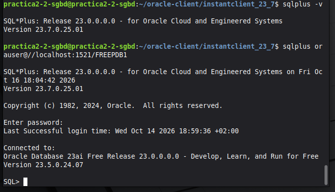

### 1.4 Cliente de terminal: SQLcl

**1. Instalo Java:**

1. `sudo apt update`
2. `sudo apt install default-jdk unzip`
3. `java --version`: compruebo que se ha instalado bien.

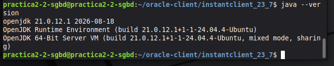

**2. Descargo SQLcl y descomprimo el ZIP:**

1. [SQLcl Download](https://www.oracle.com/database/sqldeveloper/technologies/sqlcl/download/): lo descargo desde esta página.

2. `unzip sqlcl-latest.zip -d ~/sqlcl`: descomprimo el ZIP.

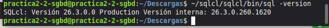

**3.** Al igual que pasaba con el Instant Client, si quiero poder escribir `sql` en cualquier ventana de la terminal de forma cómoda (sin tener que entrar a la carpeta), necesito añadirlo a las variables de entorno de mi usuario de forma permanente.

1. `echo 'export PATH="$HOME/sqlcl/sqlcl/bin:$PATH"' >> ~/.bashrc`: lo añado al archivo de configuración, para que cada vez que encienda la máquina, la terminal sepa dónde está el programa.

2. `source ~/.bashrc`: recarga ese archivo al instante para que surta efecto en la misma ventana abierta sin tener que reiniciar sesión.

**4.** Verifico que si compruebo la conexión con `orauser` a `FREEPDB1` funciona correctamente.

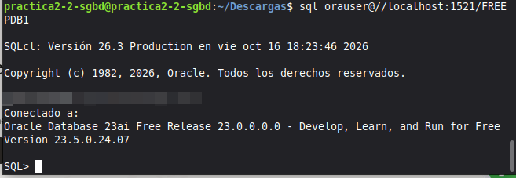

## 2. Clientes para PostgreSQL

### 2.1 Cliente de terminal: psql

Aquí voy a instalar el cliente de línea de comandos de PostgreSQL para poder conectarme a la base de datos de forma nativa desde la terminal.

- `sudo apt update`
- `sudo apt install postgresql-client`: instalo las herramientas de cliente de PostgreSQL.
- `psql --version`
- `psql -h localhost -U pguser -d dbpg -W`: es el comando de conexión. Le digo que se conecte al servidor local, con el usuario `pguser` y a la base de datos `dbpg`.

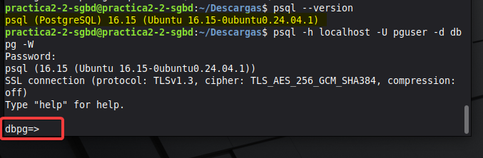

### 2.2 Cliente gráfico: pgAdmin 4

pgAdmin 4 es la herramienta gráfica oficial y más popular que existe para administrar bases de datos PostgreSQL.

**1.** pgAdmin 4 no viene en los repositorios oficiales normales de Linux Mint/Debian por defecto, o la versión está muy desactualizada. Por eso, antes de poder instalarlo, tengo que añadir el repositorio oficial y seguro de los desarrolladores de PostgreSQL/pgAdmin.

1. `sudo apt update`
2. `sudo apt install curl gnupg lsb-release`
3. `sudo apt install curl gnupg lsb-release`

4. Descargo e instalo la clave del repositorio y añado el repositorio oficial:

```bash
curl -fsS https://www.pgadmin.org/static/packages_pgadmin_org.pub | sudo gpg --dearmor -o /etc/apt/keyrings/packages-pgadmin-org.gpg

sudo sh -c 'echo "deb [signed-by=/etc/apt/keyrings/packages-pgadmin-org.gpg] https://ftp.postgresql.org/pub/pgadmin/pgadmin4/apt/$(lsb_release -cs) pgadmin4 main" > /etc/apt/sources.list.d/pgadmin4.list'
```

5. `sudo apt update`

6. `sudo apt install pgadmin4-desktop`

Abro pgAdmin desde el menú y creo una conexión a `dbpg` como `pguser`.

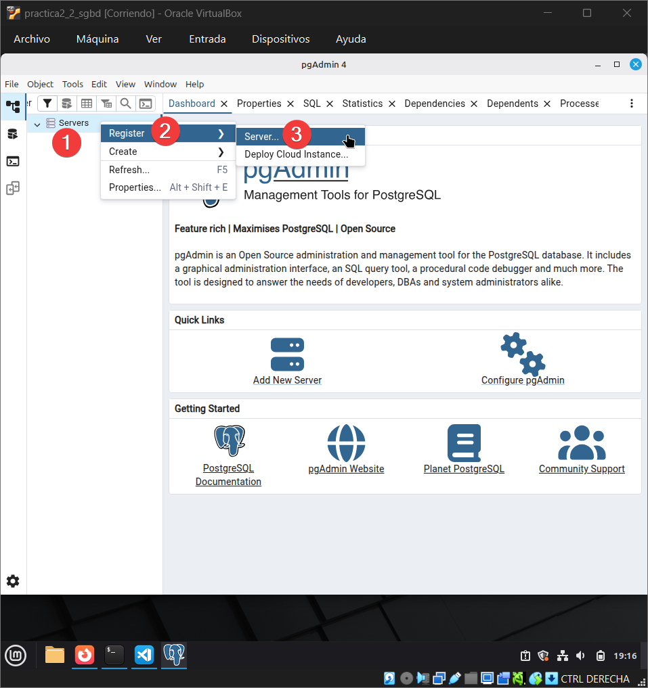

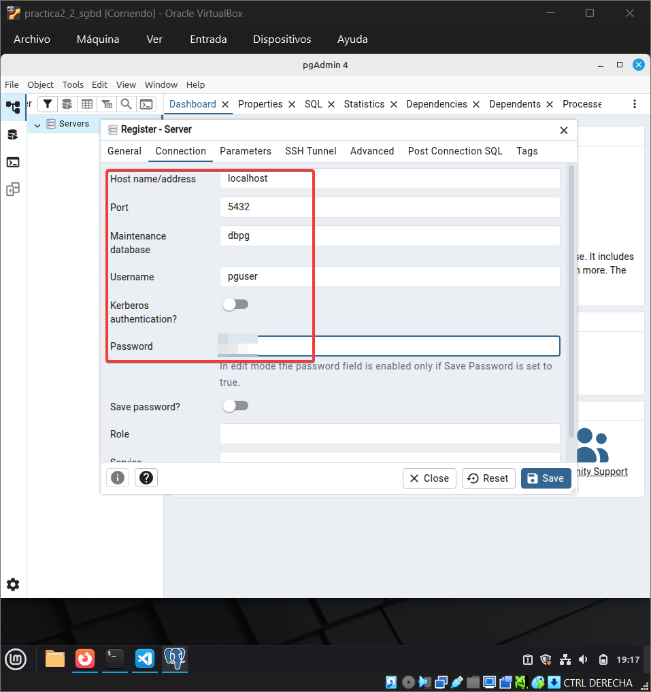

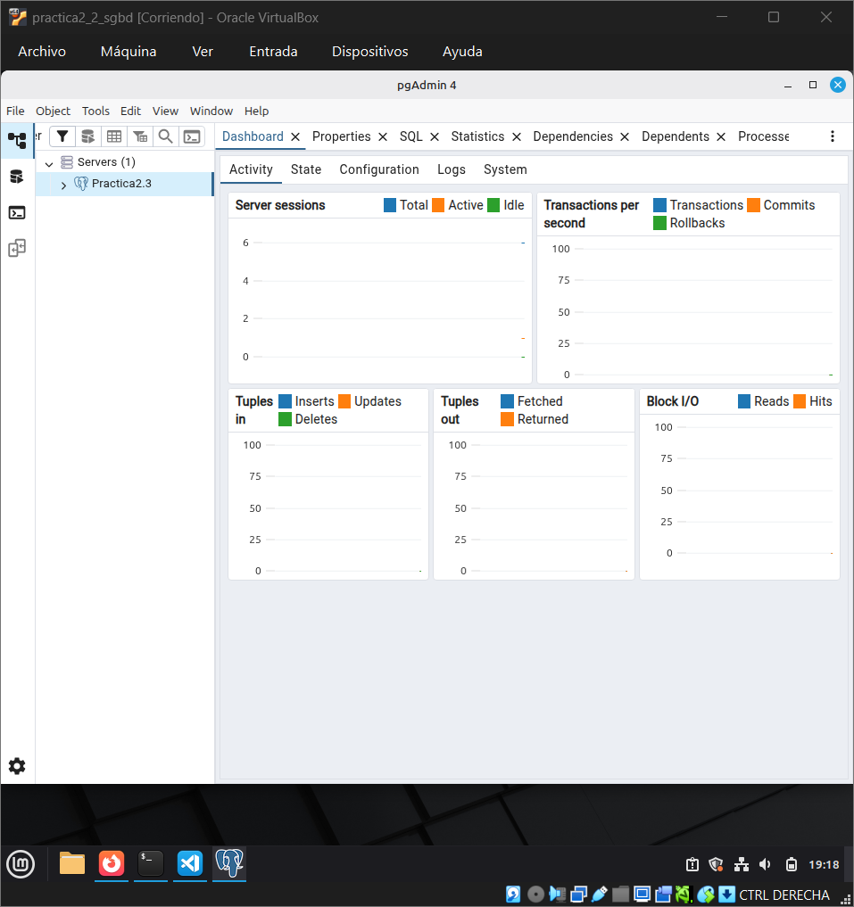


## 3.0 Clientes para MariaDB

### 3.1 Cliente de terminal: mariadb (o mysql)

El objetivo de este paso es instalar las herramientas de cliente en modo texto para MariaDB. Al igual que hice con PostgreSQL, esto me permite interactuar, hacer consultas y administrar bases de datos de MariaDB directamente desde la consola mediante comandos rápidos, sin necesidad de usar interfaces gráficas pesadas.

- `sudo apt update`
- `sudo apt install mariadb-client`
- `mariadb --version`
- `mariadb -h localhost -u muser -p dbm`

**Instalación mariadb client**

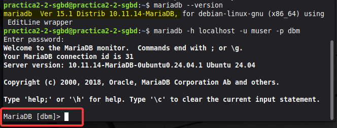

### 3.2 Cliente web: phpMyAdmin

Instalo el servidor web (Apache), PHP y phpMyAdmin.

- `sudo apt update`
- `sudo apt install apache2 php php-mysql php-mbstring php-zip php-gd php-curl phpmyadmin`: en esta parte del ejercicio me han salido varias ventanas lilas donde he seleccionado `apache2` y he asignado una contraseña a phpMyAdmin.

Verificamos que el estado del servidor web Apache esté activo.

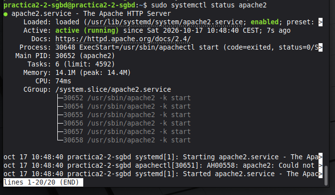

- `sudo phpenmod mbstring`: PHP necesita extensiones especiales (como `mbstring`) para procesar correctamente caracteres especiales y texto. Estos comandos activan dicha extensión en PHP.
- `sudo systemctl restart apache2`
- `sudo a2enconf phpmyadmin`
- `sudo systemctl reload apache2`

Inicio sesión en phpMyAdmin desde la dirección [http://localhost/phpmyadmin/](http://localhost/phpmyadmin/).

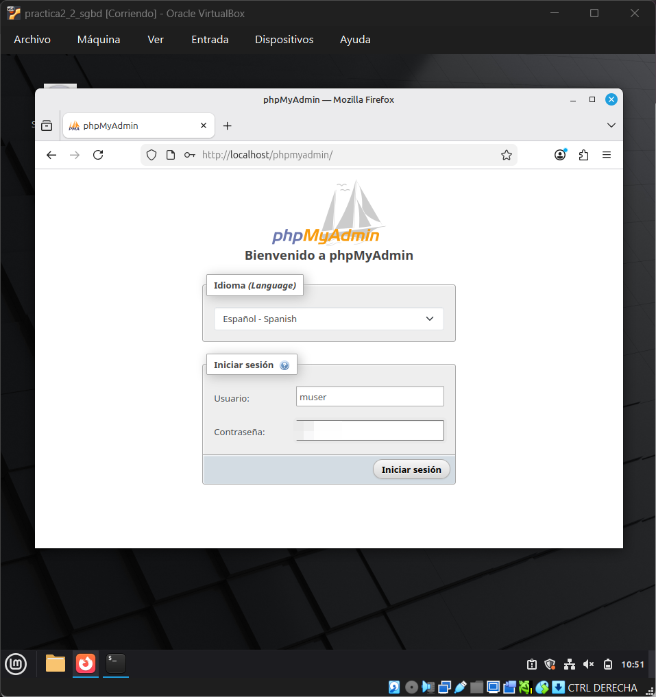

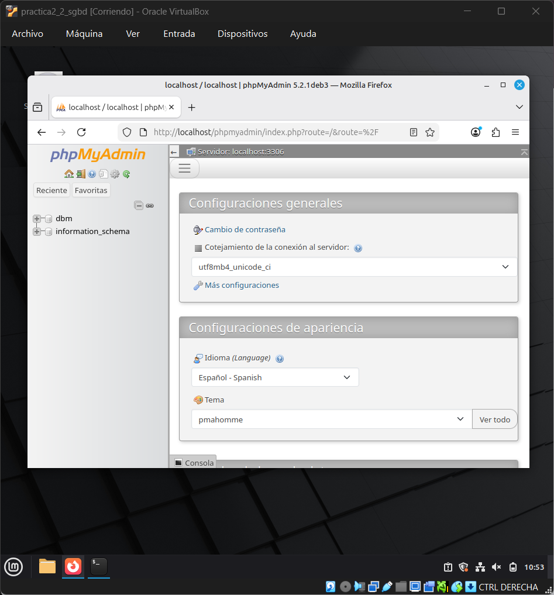

## 4. Clientes para varios SGBD

### 4.1 DBeaver Community

**1.** Descargo el paquete DEB en [Download | DBeaver Community](https://dbeaver.io/download/) y lo instalo con APT.

1. `cd ~/Descargas`
2. `sudo apt install ./dbeaver-ce-26.2.2-linux-x86_64.deb`

**2.** Entro en DBeaver y creo tres nuevas conexiones:

- `FREEPDB1` - `orauser`
- PostgreSQL `dbpg` - `pguser`
- MariaDB `dbm` - `muser`

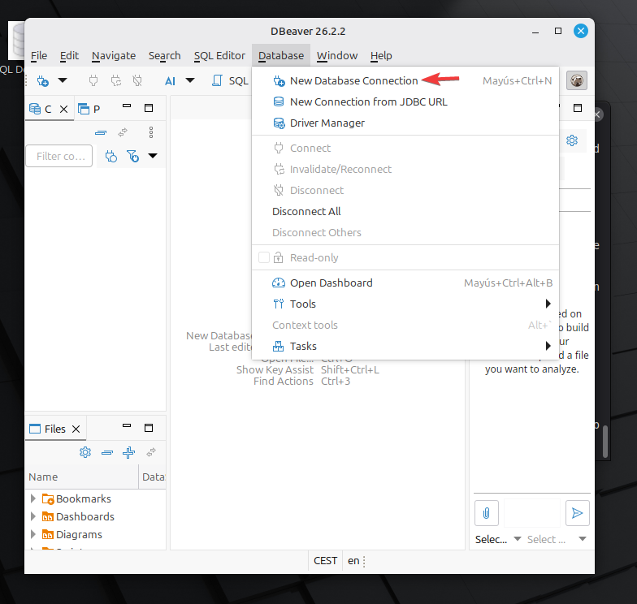

**Conexión a Oracle:**

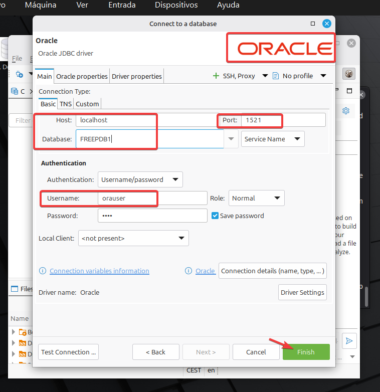

**Conexión PostgreSQL:**

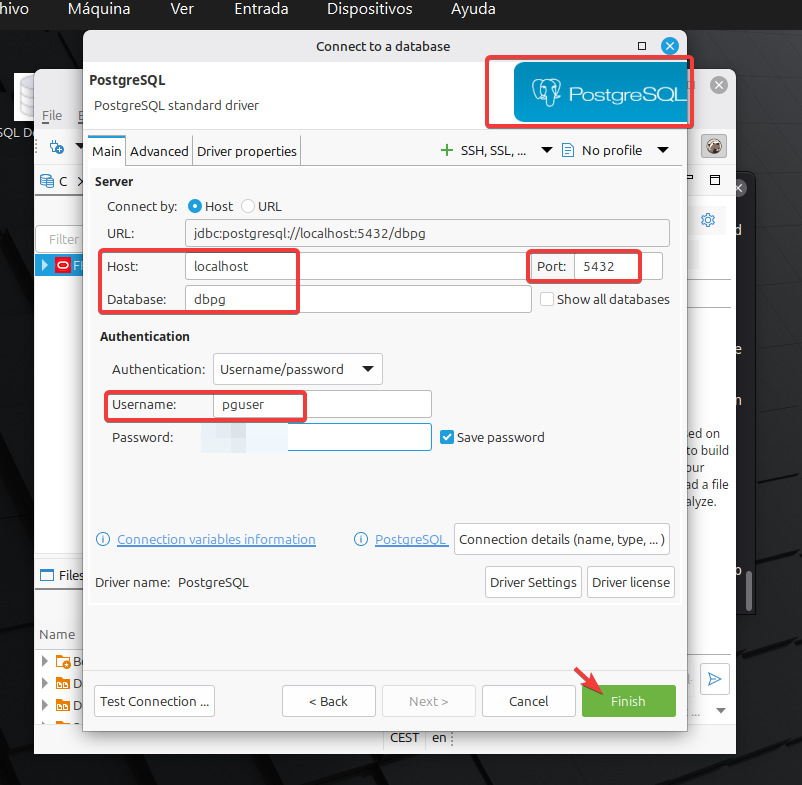

**Conexión MariaDB:**

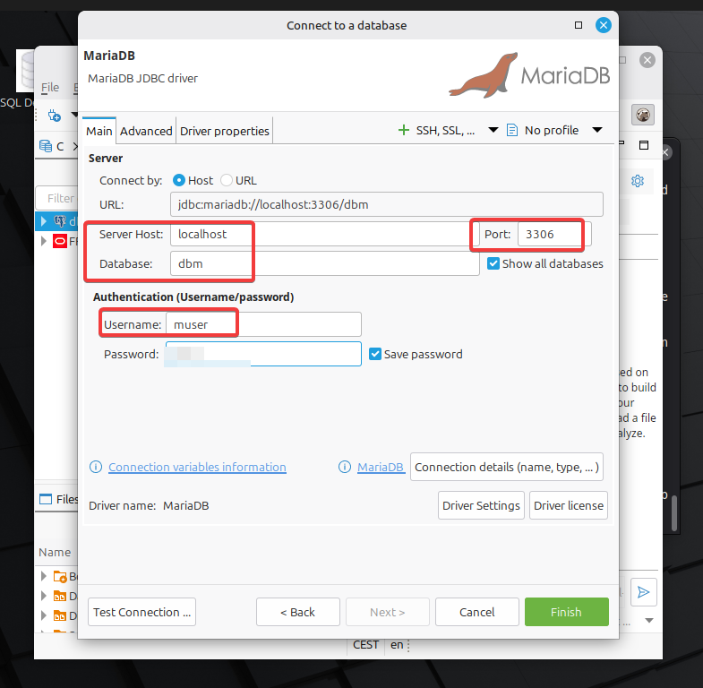

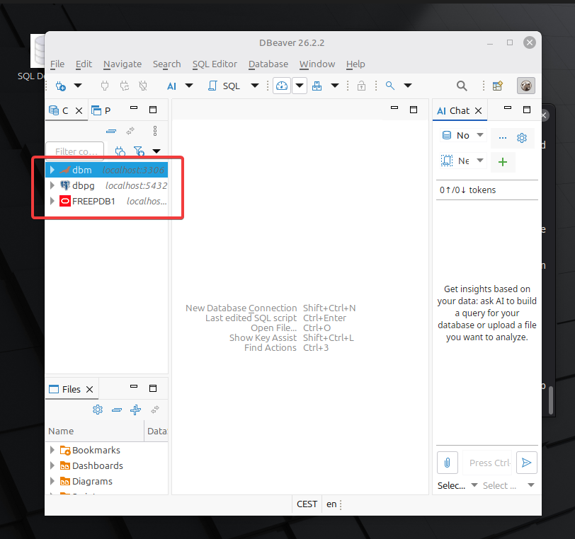

### 4.2 Adminer

Adminer es una herramienta de gestión de bases de datos de tipo web, pero con una característica muy especial: es un único archivo de código en PHP (`adminer.php`).

Mientras que otros gestores web como *phpMyAdmin* requieren instalar un montón de paquetes complejos en el sistema (servidor web Apache, extensiones de PHP, librerías, configuraciones internas, etc.), Adminer te ofrece exactamente lo mismo pero comprimido en un solo archivo. Te permite conectarte y administrar bases de datos (como MariaDB o PostgreSQL) desde cualquier navegador web de forma limpia, rápida y sin sobrecargar el ordenador.

- `sudo apt install php-cli`
- `wget https://www.adminer.org/latest.php -O adminer.php`
- `php -S 127.0.0.1:8080 adminer.php`: descargo directamente el archivo desde la web y lo guardo en mi VM con el nombre `adminer.php`.
- Escribo en el navegador de mi VM [http://localhost:8080/](http://localhost:8080/) y entro en Adminer con la conexión de MariaDB, `muser` y `dbm`.

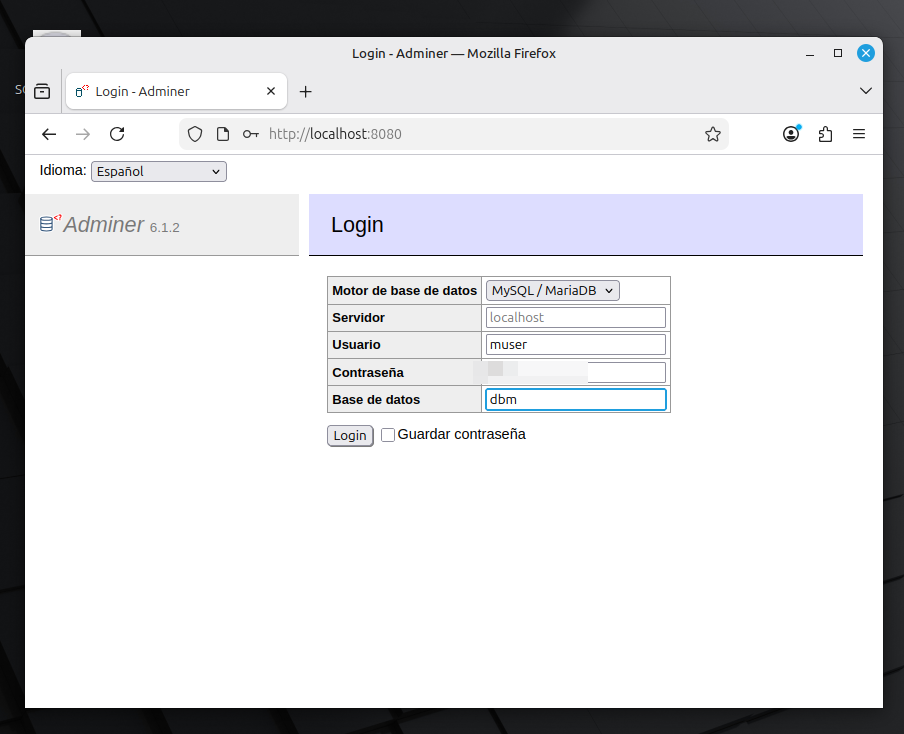

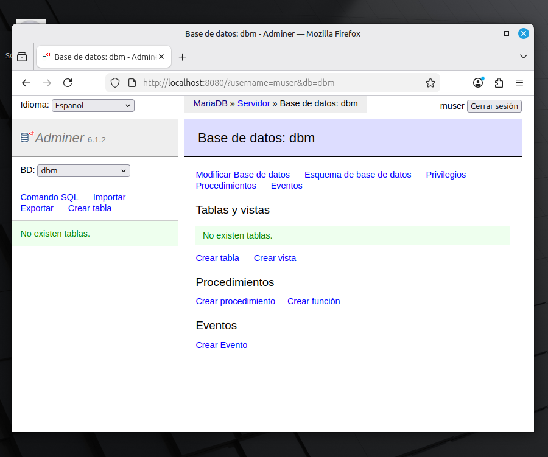

**Nota aclaratoria:** A diferencia de *phpMyAdmin* (que solo sirve para MySQL y MariaDB), Adminer es un gestor multibase de datos. Desde una única interfaz web, Adminer es capaz de conectarse a: MariaDB/MySQL, PostgreSQL, Oracle, etc.

## 5. Datos para las conexiones

En mi caso, he realizado todas las conexiones utilizando **`localhost`** porque tengo tanto los servidores como los clientes en la misma máquina virtual, tal como indicaba el enunciado de la práctica.
